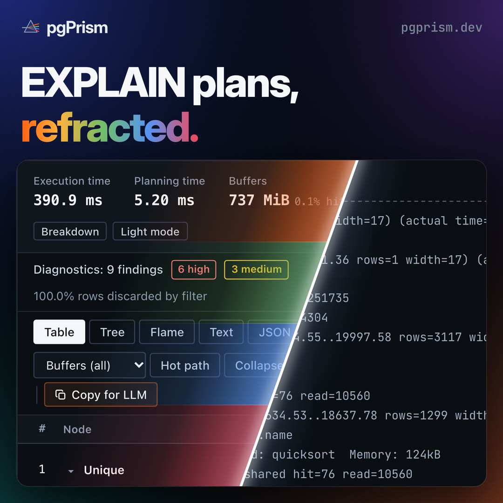

# pgPrism launch film



A 37-second, square (1080x1080), silent film that introduces [pgPrism](https://github.com/NikolayS/pgprism), a
zero-dependency viewer for Postgres `EXPLAIN` plans. It is made for feeds on phones: one key property per beat,
said by a large caption (88 px on a 1080 px frame) above a close-up of the real component, with an orange ring
or pill on the thing the caption names.

## How it's made

The film is a web page. `src/film.js` builds one paused [GSAP](https://gsap.com/) timeline and exposes
`window.__film = { fps, duration, ready, seek(t) }`; [`tools/html-film`](../../tools/html-film) asks headless
Chromium for the page at every frame time and encodes the frames with ffmpeg. Everything in the card is the real
library (`src/vendor/pgprism.iife.js`) drawing a real plan (`src/data/plans.js`), clicked by real clicks.

| Seconds | Caption | What the card shows |
|---|---|---|
| 0 – 2.2 | EXPLAIN plans, refracted. | Frame 0 is the cover: the prism-edge sweep is already half-way across the card (rendered component on the left, raw `psql` plan text on the right). It holds for 0.4 s, then the sweep finishes |
| 2.2 – 7.45 | Embed it anywhere. Blogs. / Docs. / Dashboards. / Reports. | Four mock pages slide through, each with the real component inside, tagged `<pg-plan>` (light and dark themes) |
| 7.45 – 9.95 | Tiny by design. | Three big numbers: 0 dependencies, 37 KiB gzipped, 1 script tag |
| 9.95 – 14.55 | BUFFERS first. | Zoom on the Buffers stat (737 MiB), then the table's Buffers column; the camera pans down to the seq scan on `casts` with the pill "76% in one node" |
| 14.55 – 18.05 | Finds what's wrong. | Click "Show"; the findings list opens; ring on "Shared reads: 561 MiB" |
| 18.05 – 21.75 | Jump to the node. | Click the finding's node button; the node inspector; ring on "Self shared read" |
| 21.75 – 25.85 | Table. Tree. Flame. | Real clicks on the Tree and Flame tabs; each word lights up as its view appears |
| 25.85 – 29.02 | Copy for LLM. | Click the button ("Copied"); a clipboard card shows the real `formatForLLM` output |
| 29.02 – 34.32 | One script tag. | `report.html`: the script tag is typed above a plain `<pre>` plan; the sweep turns the page into the rendered plan; stats count up |
| 34.32 – 37.32 | (end card) | Logo, pgprism.dev, `npm install pgprism`, GitHub URL, four fact chips |

The order is deliberate: what it is, why it is easy to adopt (embeds anywhere, tiny), what it does, how to set it
up, where to get it.

## Build

Requirements: Node 20+, ffmpeg with libx264, and a Chromium build (see [`tools/html-film`](../../tools/html-film#setup)).

```bash
./build.sh draft      # build/pgprism-launch-draft.mp4: 1080x1080, no motion blur, about a minute
./build.sh share      # build/pgprism-launch-1080x1080.mp4 with motion blur: the file to post, about 11 minutes
./build.sh master     # build/pgprism-launch-2160x2160.mp4 with motion blur, about 20 minutes
./build.sh poster     # build/poster/t0000.000.png: frame 0 at 2160x2160
./build.sh            # share + master + poster

# while editing (run from this folder; build.sh runs `npm ci` for you, these commands do not)
npm ci
node ../../tools/html-film/serve.mjs --page src/index.html                     # live preview with a scrubber; add --query "t=12.5" to open paused
node ../../tools/html-film/still.mjs --page src/index.html --width 1080 --height 1080 --scale 0.5 --every 1 --sheet --out build/review
node ../../tools/html-film/gif.mjs --in build/pgprism-launch-1080x1080.mp4 --out build/pgprism-demo.gif --to 9.9   # README GIF: hook + embed + tiny
```

`build.sh` first runs `verify/check.mjs` and stops if a number on screen no longer matches the plan or the bundle.
`assets/poster.jpg` is the poster scaled down:
`ffmpeg -i build/poster/t0000.000.png -vf scale=1080:1080:flags=lanczos -q:v 3 assets/poster.jpg`.

## Where to change things

- Captions and sub-captions: `CAPS` in `src/film.js` (headlines shrink to fit the width by themselves).
- Timing, camera moves, rings, the pill, cursor paths: `buildTimeline()`. Beat start times are kept in
  `window.__marks` (read them in the browser console of the preview).
- The four host pages: `HOSTS` (URL, heading, theme) and the `.host` / `.h-*` rules in `src/film.css`. The three
  numbers: `buildNums()`. The typed script tag: `buildSetup()`. The clipboard card: `buildClip()`.
- The plan: `PLAN` picks a key from `src/data/plans.js`; `HOT_NODE` names the node the film follows (pill, picked
  finding, inspector). The caption "9 findings… 6 are high", the pill "76% in one node", the "Shared reads:
  561 MiB" finding and the numbers on the host pages are facts about that plan: change them with it, then run
  `node verify/check.mjs`.
- End card (URL, npm command, chips) and the brand row: `src/index.html`.
- Colours, type sizes, card geometry: `src/film.css`.

How the shots work: the component repaints itself on every state change, so the film mounts one real instance per
UI state (`addPage` / `mount` in `boot()`: table, findings open, node selected, tree, flame) and cuts between them
on the clicks. Each instance is a "page" inside the card with its own camera (`pg.view = {x, y, s}`).
`src/probe.html` renders one instance at a given width and state for framing work
(`?w=480&view=table&z=2&diag=1&sel=1&metric=buffers&theme=dark`) and leaves the boxes of its main parts in
`window.__probe`.

To pick up a new pgPrism build, copy its `dist/pgprism.iife.js` over `src/vendor/pgprism.iife.js` and re-check
every close-up: camera targets are measured from the live layout, but captions and the "37 KiB" figure are not.
The film mounts the component without Shadow DOM, so film CSS can leak into it; the library uses an unprefixed
`.num` class, so nothing in `src/film.css` may be called `.num`. Media queries follow the viewport, not the card,
so the component's phone layout does not apply inside the film.

## Facts

Every on-screen claim is in [`verify/claims.md`](verify/claims.md); the numeric ones are re-derived by
`verify/check.mjs` on every build.

## Assets and credits

- `src/vendor/pgprism.iife.js`: pgPrism `0.1.0-beta.1` (commit `651f5b9`), Apache-2.0.
- `src/data/plans.js`: a public plan from [explain.depesz.com/s/Uto3s](https://explain.depesz.com/s/Uto3s), the
  first sample on the pgPrism demo page.
- Fonts, installed from npm and not committed (SIL OFL): Inter, JetBrains Mono, Instrument Serif.
- GSAP, installed from npm and not committed ([standard "no charge" licence](https://gsap.com/standard-license)).
